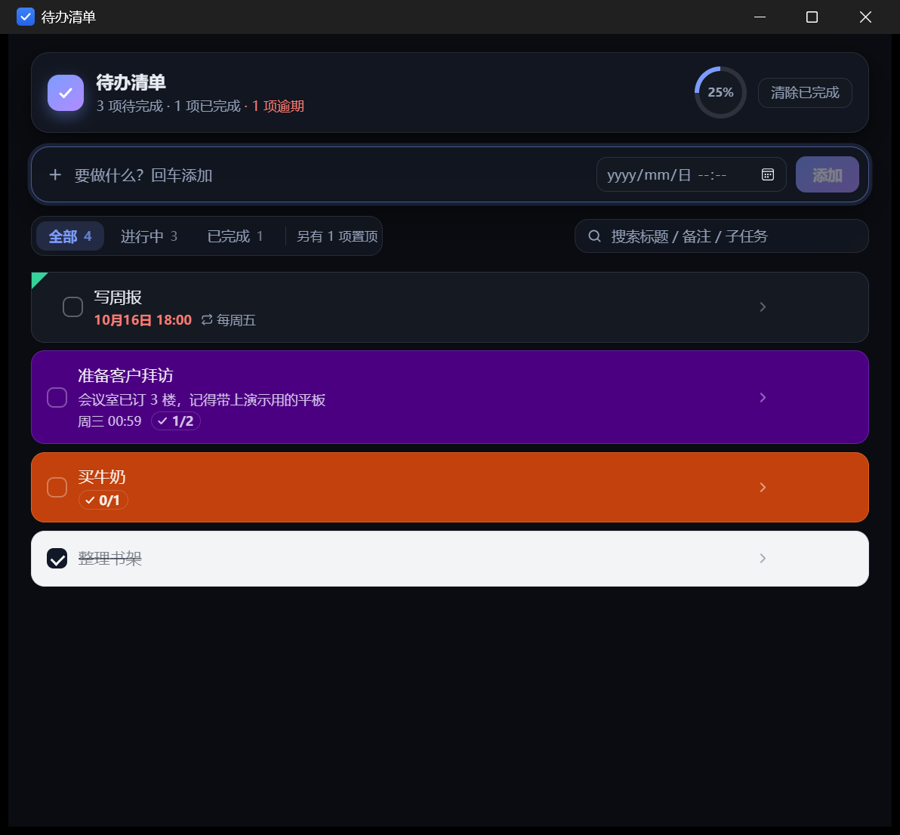
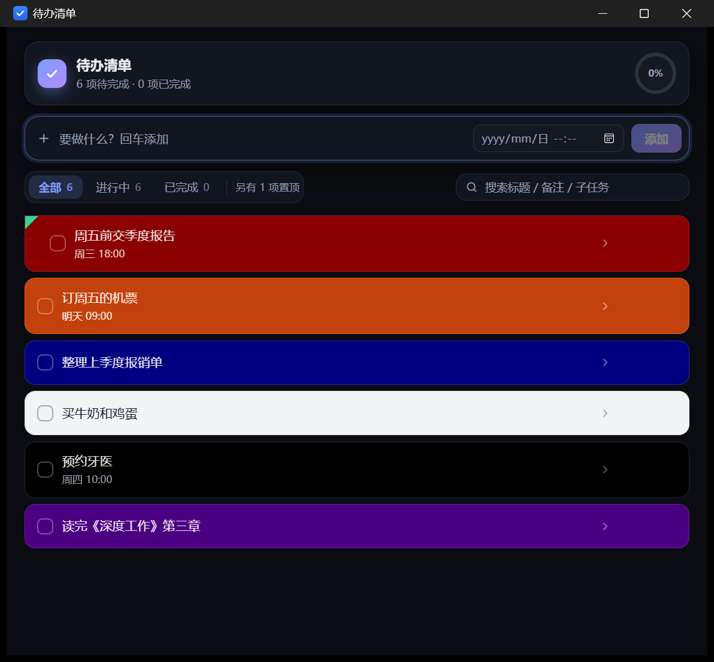
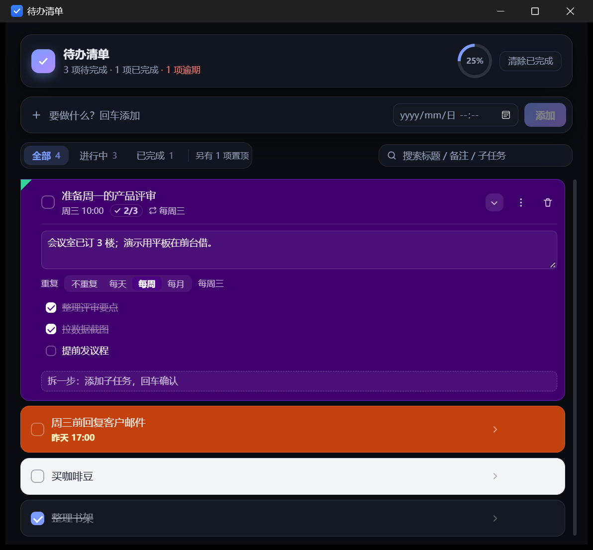
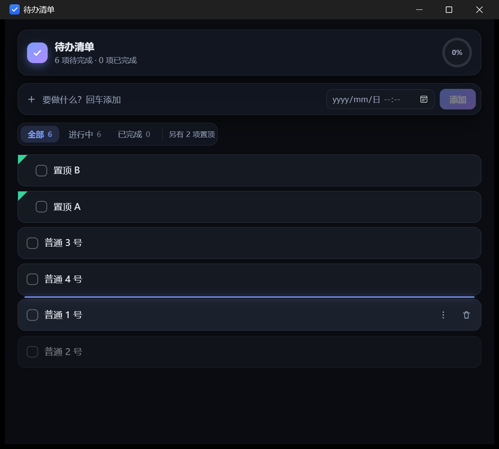
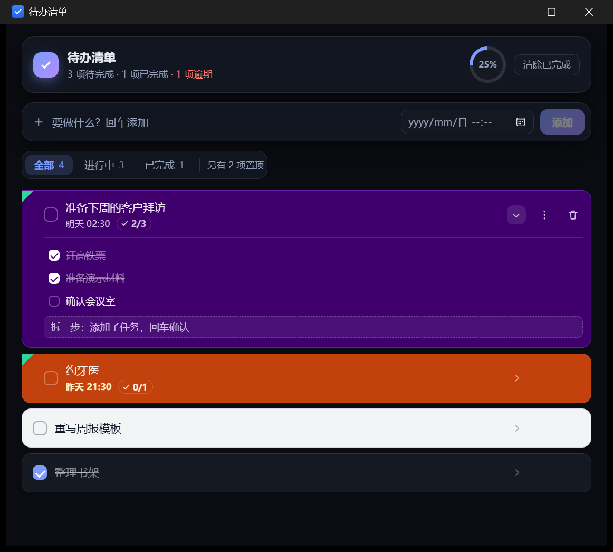

# 待办清单（本地 Todolist）

一个纯本地的 Windows 桌面待办应用：数据只存在自己电脑上的一个 SQLite 文件里，不联网、不上传、不需要账号。



技术栈：**Tauri 2（Rust 后端）+ Vue 3 + TypeScript + SQLite**

---

## 快速上手



- **加一条**：顶部输入框敲标题，回车；右边的日期框可以顺手设截止时间
- **改内容**：双击标题就地改
- **勾完成**：点复选框；顶部「清除已完成」一键收拾
- **换颜色 / 置顶**：卡片右侧 `⋮`（或直接右键卡片）→ 选底色、置顶
- **排顺序**：按住卡片上下拖，蓝色插入线指示落点；置顶区和非置顶区各自排序、互不穿越
- **找东西**：右上角搜标题 / 备注 / 子任务
- **随时记一笔**：`Ctrl+Shift+Space` 在任何程序里唤出输入框，回车后窗口自动收回托盘



点卡片右侧的箭头展开详情：写备注（失焦自动保存）、设重复（每天 / 每周 / 每月）、拆子任务。

桌面端还有几件事：关窗口只是收进托盘（右键托盘图标退出）、任务到点弹 Windows 通知、数据每天自动备份 7 份。

---

## 为什么选这套架构

| 关注点 | 实测结果 |
| --- | --- |
| exe 体积 | **8 MB 出头**（单文件，双击即用；Electron 同类应用通常 100 MB+） |
| 启动速度 | 秒开，无明显白屏 |
| 内存占用 | 常驻几十 MB 量级（复用系统 WebView2，不打包浏览器内核） |
| 数据可靠性 | SQLite 事务 + WAL；每天首次启动自动做一份一致性快照 |
| 开发效率 | UI 用 Vue 写，`pnpm tauri dev` 热更新；只有需要系统能力时才动 Rust |
| 后续扩展 | 托盘、全局热键、系统通知都有官方插件 |

## 目录结构与分层

依赖只能**单向向下**，UI 绝不直接执行 SQL。

```
todolist/
├─ src/                         # 前端（表现层）
│  ├─ main.ts                   # 入口
│  ├─ App.vue                   # 页面骨架：顶栏 / 输入区 / 过滤器 / 列表 / 选项栏
│  ├─ components/
│  │  ├─ TaskComposer.vue       # 顶部输入框（标题 + 可选截止时间）
│  │  ├─ TaskItem.vue           # 单条任务：勾选、改名、置顶角标、拖拽、子任务面板
│  │  └─ TaskMenu.vue           # 三点/右键选项栏：6 种底色 + 置顶
│  ├─ composables/
│  │  ├─ useDragSort.ts          # 拖拽排序（分组约束 + 自动滚动 + 插入位计算）
│  │  └─ useReminders.ts         # 到期提醒轮询（托盘里也继续跑）
│  ├─ stores/taskStore.ts       # 状态层：内存唯一数据源 + 所有 action
│  ├─ services/
│  │  ├─ taskService.ts         # 业务层：校验、默认值、状态流转
│  │  ├─ subtaskService.ts      # 子任务增删改
│  │  ├─ reminderService.ts     # 取到期任务并标记已提醒
│  │  ├─ notifyService.ts       # 系统通知（直连插件 IPC）
│  │  └─ backupService.ts       # 每日备份（调 Rust 拿路径 + VACUUM INTO）
│  ├─ repositories/             # 仓储层：SQL ↔ 领域对象映射
│  │  ├─ taskRepository.ts
│  │  └─ subtaskRepository.ts
│  ├─ db/connection.ts          # 数据库连接（单例）
│  ├─ theme/colors.ts           # 6 种底色的配色 token（CSS 变量 + 对比度说明）
│  ├─ types/task.ts             # 领域模型
│  ├─ types/subtask.ts          # 子任务模型
│  ├─ utils/datetime.ts         # UTC ↔ 本地时间、逾期判断、友好时间格式
│  └─ styles.css                # 主题 + 玻璃拟态样式
├─ src-tauri/                   # 原生层
│  ├─ src/lib.rs                # 单实例锁 + 托盘 + 迁移 + 备份/日志命令
│  ├─ src/main.rs               # exe 入口
│  ├─ tauri.conf.json           # 窗口、标识、打包配置
│  └─ capabilities/default.json # 权限白名单（只放开需要的）
├─ app-icon.png                 # 图标源图（1024×1024）
└─ docs/screenshot.png
```

```
UI (.vue)  →  Store (Pinia)  →  Service (规则)  →  Repository (SQL)  →  SQLite
                                  ↑ 只允许这个方向 ↑
```

**为什么这么分**：加字段改 `types` + 迁移 + repository；加规则改 service；改交互只动 `.vue`。
不会出现"点一个按钮，四个文件里的逻辑各改一半"。

## 界面：玻璃拟态与层次

克制地用玻璃——只给**顶栏、输入区、过滤器、选项栏浮层**加 `backdrop-filter`，
任务卡片保持实心。这样层级是：背景光晕 → 玻璃工具层 → 实心内容卡片，而不是"糊成一团"。

- 背景：三团柔和径向渐变，深色模式下会加强，否则玻璃层背后没有东西可折射
- 任务卡片：底色完全由 `--task-*` CSS 变量驱动，换配色只换一组变量
- 主题：跟随系统深浅色，`prefers-reduced-motion` 下自动关闭动画

## 搜索

顶部工具栏右侧的搜索框，边打边过滤，命中范围是**标题 / 备注 / 子任务标题**——
所以搜「低脂」能找到主任务叫「买牛奶」、但子任务写着「低脂的那种」的那一条。

- 命中数量显示在筛选条右侧（"匹配 N 条"）
- 搜索状态下拖拽排序会自动关闭（可见的只是子集，重排会打乱与隐藏条目的相对顺序）
- 纯内存过滤，不查库、不建索引 —— 几百条量级完全够用

## 六种底色

底色与文字按对比度配对（详见 `src/theme/colors.ts`）：

| 底色 | 文字 | 对比度 |
| --- | --- | --- |
| 白色 `#FFFFFF` | 深灰黑 `#111827` | ≈ 17.8:1 |
| 黑色 `#000000` | 近白 `#F8FAFC` | ≈ 19:1 |
| 深蓝 `#000080` | 白色 `#FFFFFF` | ≈ 16:1 |
| 深红 `#8B0000` | 白色 `#FFFFFF` | ≈ 10:1 |
| 深橙 `#C2410C` | 白色 `#FFFFFF` | ≈ 5.2:1 |
| 靛蓝 `#4B0082` | 白色 `#FFFFFF` | ≈ 13:1 |

每种底色除正文色外，还配了次级文字、描边、悬停、勾选框、勾号、逾期色，
否则换成深蓝底就会出现"看不清的灰字"或者"蓝勾和深红底糊在一起"。

## 置顶与选项栏

- 每条任务右侧有 `⋮` 按钮，**右键任务任意位置**也能唤出同一个选项栏
- 选项栏内：6 个色块（含"不指定，跟随主题"的默认项）+ 置顶/取消置顶
- 置顶的任务左上角有一个**绿色实心等腰直角三角形**；为了让它两条直角边真正与卡片边框重合，
  置顶时该卡片的左上角会被切成直角
- 排序：**手动拖拽**决定。置顶区永远在上，非置顶区在下，两块各自排序、互不穿越

## 拖拽排序



- 在「全部」视图里按住卡片上下拖动，出现一条蓝色插入线，松手落位
- 移动超过 4px 才算拖拽，所以点击勾选框、双击改名都不会误触发
- **两个分组互不穿越**：非置顶项拖到置顶项上方会被夹在非置顶区顶部，置顶项拖到非置顶区下方会被夹在置顶区末尾
- 靠近列表上下边缘会自动滚动，方便长列表
- 过滤视图（进行中 / 已完成）里拖拽是关闭的 —— 那里看到的只是子集，
  在子集上重排会打乱它和隐藏条目的相对顺序
- 位置写入 `sort_order` 字段，只更新真正变化的行（拖一条通常 3~8 行）

顺带的行为约定：

| 事件 | 落在哪 |
| --- | --- |
| 新建任务 | 非置顶组的**最前面**（就在输入框下方，加完立刻可见） |
| 置顶 | 置顶组的**最前面** |
| 取消置顶 | 非置顶组的**最前面**（紧贴置顶区下方，位置变化最小） |
| 勾选完成 | **不动**（手动排序下，勾一下就让卡片跳走会很烦） |

> 注意：用了手动排序之后，**按截止时间自动排序就不再生效了**——任何自动排序键都会让拖拽结果"弹回去"。
> 截止时间仍然会显示，逾期仍然标红。

## 子任务



- 点卡片右侧的箭头（或 `1/3` 进度徽标）**就地展开**，不弹窗、不跳页
- 展开后有子任务清单和一行「拆一步」输入框，回车即添加
- 主卡片上显示 `done/total` 进度徽标，勾掉最后一条子任务也不会自动完成主任务（两件事分开）
- 子任务存在独立的 `subtask` 表，不塞进 JSON 字段——以后要按子任务统计/搜索都方便

## 备注

- 卡片上只显示**一行灰色摘要**，不占地方；点箭头展开才看到全文
- 展开后是一个备注框，**失焦自动保存**（不用点保存按钮）
- 存数据库的 
otes 字段，超过 2000 字会被输入框截断

## 循环任务

「每周五写周报」这类任务：在详情面板里选 **每天 / 每周 / 每月**，规则会跟随当前截止时间推导
（每周 = 截止日那天的星期几；每月 = 截止日那天的几号）。

**勾选完成时不会停在"已完成"**，而是把截止时间顺延到下一次、同时清掉提醒标记：

| 场景 | 行为 |
| --- | --- |
| 每周五 18:00 的任务，今天是周一，勾掉 | 直接排到下周五 18:00（跳过已过期的那次） |
| 每月 31 号的任务，二月 | 自动落到 2 月 28/29 号 |
| 没有截止时间的任务 | 循环选项禁用，先设时间 |

卡片上用 🔁 图标 + "每周五" 标出重复规则。

> 实现细节：	ask.done 前后都是 alse，Vue 的 :checked 认为没变化就不会回写 DOM，
> 那个勾会一直挂在框里。所以勾选后要手动把 DOM 状态拉回和数据一致 —— 这是循环任务里最容易漏的一个坑。

## 到期提醒

- 应用常驻托盘，后台每 20 秒扫一次：**没完成 + 有截止时间 + 还没提醒过 + 时间已到** 的任务
- 每轮最多弹 3 条，积压太多时分会几轮弹，不会一次糊满屏幕
- 弹过就写 `notified_at`，不会重复打扰；窗口收进托盘时照样提醒
- 发送失败会写进 `%APPDATA%\com.dsh.todolist\app.log`

**踩到并修掉的一个坑**：`@tauri-apps/plugin-notification` 2.7 的 `sendNotification()`
内部用的是浏览器的 `new window.Notification()`，而 **WebView2 里这个 API 是静默空操作** ——
既不报错也弹不出来。改成直接调插件 IPC 命令（`plugin:notification|notify`）后，
Windows 才真正收到这条通知（可通过 `HKCU\...\Notifications\Settings\com.dsh.todolist` 验证）。

> Windows 侧的另外两个前提（不是代码能解决的）：
> 1. **必须用安装包装**。插件只在非 `target/release` 路径下设置 AppUserModelID，
>    而 Toast 需要开始菜单里带 AUMID 的快捷方式 —— 安装包会自动创建。
> 2. 系统「勿扰/专注模式」或关闭「通知横幅」时，Toast 会被系统吞掉（可在操作中心里看到）。
>    遇到"提醒不弹"，先看这两项，再看 `app.log` 有没有 `已发送提醒`。

## 数据与备份

- 主库：`%APPDATA%\com.dsh.todolist\todolist.db`（含 WAL）
  **不放在 exe 旁边**，否则装到 Program Files 后没有写权限
- 备份：`%APPDATA%\com.dsh.todolist\backup\todolist-yyyyMMdd.db`，每天首次启动做一次，保留最近 **7** 份
- 备份方式用 SQLite 的 `VACUUM INTO`，而不是复制文件——WAL 模式下直接复制可能漏掉还在 `-wal` 里的事务；
  `VACUUM INTO` 读到的一定是一个完整快照
- 表结构由 `src-tauri/src/lib.rs` 的迁移创建；迁移只增不改，改表就追加一条
- 时间统一存 UTC ISO8601，只在展示层转本地时区；删除是**软删除**（写 `deleted_at`）

```sql
CREATE TABLE task (
  id TEXT PRIMARY KEY, title TEXT NOT NULL, notes TEXT,
  done INTEGER NOT NULL DEFAULT 0, due_at TEXT, priority INTEGER NOT NULL DEFAULT 0,
  color TEXT, pinned_at TEXT, sort_order REAL, notified_at TEXT,
  created_at TEXT NOT NULL, updated_at TEXT NOT NULL, deleted_at TEXT
);

CREATE TABLE subtask (
  id TEXT PRIMARY KEY, task_id TEXT NOT NULL, title TEXT NOT NULL,
  done INTEGER NOT NULL DEFAULT 0, sort_order REAL NOT NULL DEFAULT 0,
  created_at TEXT NOT NULL, updated_at TEXT NOT NULL
);
```

`sort_order` 是手动排序键；迁移 5 加字段时会用窗口函数 `ROW_NUMBER()` 按旧的自动排序回填一次，
保证升级后列表顺序和升级前一模一样。

## 单实例

用 `tauri-plugin-single-instance`（必须是注册的第一个插件）：重复双击 exe 不会开第二个窗口，
而是把已有窗口还原并拉到最前。这样避免两个进程同时写同一个库。

## 托盘常驻

- 点窗口的 **X 不会退出**，只是把窗口收进系统托盘；进程继续活着（这也是以后做"到点提醒"的前提）
- **左键点托盘图标**：把窗口叫回来
- **右键托盘图标**：菜单里可以「显示主窗口」/「退出」，`退出` 是唯一的正常退出入口
- 首次启动会在界面上给一条一次性提示，说明"关窗口不等于退出"
- 托盘图标默认落在 Windows 的"隐藏的图标"溢出区（系统对新图标的一贯策略），
  想让它常驻任务栏可以在系统设置里拖出来/固定

实现见 `src-tauri/src/lib.rs`：`build_tray()` 建图标和菜单，`on_window_event` 里拦截
`CloseRequested` 并 `hide()`。

## 全局快捷键

- 任何程序在前台时按 `Ctrl+Shift+Space`：窗口立刻弹出、输入框自动聚焦，进入「快速记一笔」模式（输入区边框会点亮）
- 输入后回车 → 任务落库，**窗口自动收回托盘**，不打断手头的事
- Esc、或者点到别的窗口让它失焦，就退出快速模式；之后再回车只添加、不隐藏窗口

实现：`tauri-plugin-global-shortcut` 在 Rust 侧注册，按下时 `show()` + `emit("quick-add")`；
前端收到事件后聚焦输入框，添加完成再调 `hide_main_window` 命令收回去（走命令而不是 JS 窗口 API，省掉一层权限白名单）。

## 运行环境

| 项 | 要求 |
| --- | --- |
| 系统 | Windows 10 1809 及以上 / Windows 11（x64） |
| WebView2 | Win11 自带；Win10 缺失时**安装包会自动下载一次**（需联网） |
| 管理员权限 | **不需要**（NSIS 以 currentUser 安装到 %LOCALAPPDATA%） |
| 其它运行时 | **无**。不需要 .NET / Java / Node，装好即可离线使用 |
| 磁盘 | 安装约 10 MB；数据库与备份在 %APPDATA%，卸载不删 |
| 内存 | 常驻几十 MB（复用系统 WebView2，不打包浏览器内核） |

> 绿色单文件版（	odolist.exe）**不会**自动装 WebView2，需要系统里已经存在。

## 开发与构建

前置：Node.js 20+、Rust stable（MSVC 工具链）、WebView2 Runtime（Win11 自带）。

```bash
pnpm install                   # 装前端依赖
pnpm tauri dev                 # 开发模式（热更新）
pnpm tauri build               # exe + NSIS 安装包
pnpm tauri build --no-bundle   # 只要单独的 exe
```

产物：`src-tauri/target/release/todolist.exe`、`src-tauri/target/release/bundle/nsis/*.exe`

> 本机已装好 Rust 1.99（MSVC）+ VS Build Tools 2022（MSVC 14.44 + Win11 SDK）。
> 如果 `pnpm`/`node` 没装到全局，请先 `winget install OpenJS.NodeJS.LTS` + `npm i -g pnpm`，
> 否则需要借用 `scripts/bin/pnpm.cmd` 这个垫片来构建。

## 当前功能

- [x] 新增（回车或点"添加"）/ 勾选完成 / 双击标题改名 / 删除
- [x] 可选截止时间，逾期条目红色标注（"昨天 18:00" 这种人类可读格式）
- [x] 全部 / 进行中 / 已完成 过滤 + 顶部完成度圆环
- [x] 一键清除已完成；软删除
- [x] 6 种彩色底色（浅灰/黑/深蓝/深红/深橙/靛蓝）+ 跟随主题的默认色，配套文字色，三点/右键选项栏
- [x] 置顶（绿色三角角标）+ 置顶排序
- [x] 鼠标拖拽手动排序（置顶区 / 非置顶区各自独立，互不穿越）
- [x] 子任务：就地展开、进度徽标、增删勾选
- [x] 备注：卡片一行摘要 + 展开编辑，失焦自动保存
- [x] 搜索标题 / 备注 / 子任务标题
- [x] 循环任务（每天 / 每周 / 每月），勾选后自动顺延
- [x] 到期弹 Windows Toast 提醒（托盘里也继续跑）
- [x] 单实例锁
- [x] 托盘常驻：关窗口不退出，左键唤回，托盘菜单退出
- [x] 全局快捷键 Ctrl+Shift+Space 快速记一笔（记完自动收回托盘）
- [x] 每日自动备份，保留 7 份
- [x] 深色 / 浅色主题跟随系统

## 后续路线（按性价比排序）

1. 开机自启（`HKCU\...\Run`）—— 托盘常驻已就绪，这是下一步
2. 任务备注 + 搜索（任务积累到几十条后搜索是刚需）
3. 循环任务（RRULE）与标签系统
4. 导出 / 导入 JSON；备份管理界面（查看/回滚）
